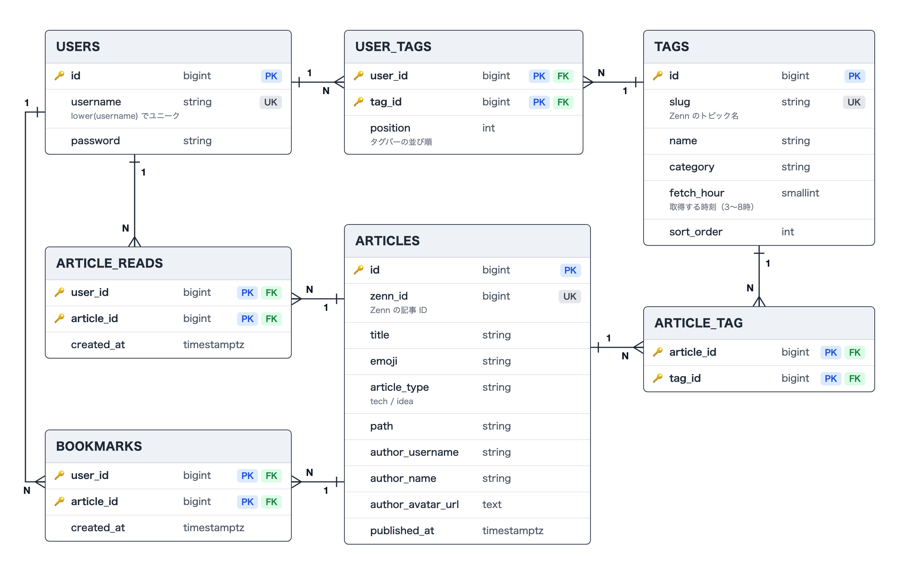

# Zenn News

Laravel + Next.js 構成の、Zenn の記事をお気に入りのタグごとに新しい順で読めるニュースアプリです。

## デモ

- 公開ページ: https://frontend-production-7916.up.railway.app

## ER図



## 主な機能

- お気に入りタグ（42タグ・7カテゴリから選択。選んだ順にタグバーに並び、ワンタップで切り替え）
- NEW / READ / BOOKMARK の3タブ（開いた記事は READ へ。開いた直後の記事はタブを切り替えるまで NEW に薄く残す）
- ブックマーク（最大100件。タグの最新100件から外れた記事も残る）
- 記事の自動取得（毎朝3〜8時に、タグごとに最新30件を取得し、1タグ最大100件を保持）
- ユーザー名とパスワードによる登録・ログイン（Sanctum トークン認証、登録・ログイン試行のレート制限つき）

意図的にスコープ外にしたもの: 記事本文の表示（Zenn のページを開く）、検索、いいね・コメント、ページネーション、メールアドレス・パスワードリセット

## 技術スタック

| 層             | 技術                                                                                                                         |
| -------------- | ---------------------------------------------------------------------------------------------------------------------------- |
| バックエンド   | Laravel 13 / PHP 8.4 / FrankenPHP / Laravel Sanctum（トークン認証）/ PostgreSQL 17 / Pest / Laravel Pint / Larastan          |
| フロントエンド | Next.js 16（App Router）/ React 19 / TypeScript / Tailwind CSS 4 / TanStack Query / react-hook-form + zod / Vitest + Testing Library + MSW |
| 外部API        | Zenn の記事一覧 API（非公式）                                                                                                 |
| インフラ       | Railway（Dockerfile ビルド、GitHub 連携による自動デプロイ、Railway Cron）/ Docker Compose（ローカル）/ GitHub Actions（CI）  |

## アーキテクチャ

```
backend/    Laravel — ビューを持たない純粋な JSON API と、記事取得コマンド
frontend/   Next.js（App Router）
docker-compose.yml  ローカル開発用
```

- 本番は Railway に frontend / backend / cron / PostgreSQL の4サービスをデプロイ。公開しているのは frontend だけで、backend と DB は Railway の内部ネットワークからのみ呼べる。
- ブラウザは Next.js の Route Handler（`/api/*`）だけを呼び、Route Handler が HttpOnly Cookie の Sanctum トークンを付けて Laravel へ中継する。トークンはブラウザの JavaScript から見えない。
- タグごとの記事一覧（`/home/[slug]`）は全員共通のデータなので ISR でキャッシュし、タグを切り替えても Laravel へはアクセスしない。キャッシュは取得コマンドが記事を保存したあと `/api/revalidate` に通知して即時再検証し、通知が届かなかった場合も8時間で作り直す。
- 既読・ブックマーク・お気に入りタグは個人のデータなので CSR。ホームを開いたときに `GET /api/me/home` で1回だけまとめて取得して TanStack Query に置き、操作時は楽観的更新でキャッシュを直接書き換える。NEW / READ は、記事一覧と既読 ID をブラウザで組み合わせて作る。
- `generateStaticParams` が空の ISR ページはブラウザ側で動的ページとみなされ、標準のプリフェッチが行われない。そのため、ホームを開いたときに `router.prefetch(href, { kind: "full" })` でお気に入りタグのページをすべて先読みし、タグ切り替えを通信なしで行えるようにしている（`frontend/src/hooks/usePrefetchTagPages.ts`）。
- Laravel から見ると全リクエストが Next.js から来るため、Next.js が Railway の入口の付ける `X-Real-IP` を `X-Forwarded-For` として Laravel に渡し、Laravel は `trustProxies` で信用する。これでレート制限を訪問者ごとに効かせている（Laravel を公開しないことが前提）。
- 記事の取得は Railway Cron（`0 18-23 * * *` UTC）が `php artisan zenn:fetch-articles` を毎時実行する。各時刻に担当の7タグを1秒間隔で取得し、1タグが失敗しても次のタグへ進む。

## Zenn のデータの扱い

- Zenn 公式のアプリではありません。記事の一覧は Zenn の非公式 API から取得しています。
- 保存するのはタイトル・絵文字・著者名・著者アイコンの URL・記事へのリンクだけで、本文は保存・表示しません。
- Zenn へのアクセスは記事の取得コマンドだけ（1日42回、1秒間隔）で、利用者が増えても増えません。User-Agent にこのリポジトリの URL を入れ、アクセス元を明示しています。
- ポートフォリオとして提出したあとは、個人用として使う予定です。

## ディレクトリ構成（抜粋）

```
backend/
  app/Http/Controllers/Api/     公開API・認証・ログイン必須のAPI
  app/Console/Commands/         記事の取得コマンド（zenn:fetch-articles）
  app/Services/                 Zenn APIクライアント、記事の保存、Next.js への再検証通知
  app/Models/                   User, Tag, Article
  database/migrations/
  database/seeders/             TagSeeder（42タグ）
  tests/Feature/                Pestによる機能テスト

frontend/src/
  app/(public)/, app/(auth)/    トップ（SSG）、ログイン・新規登録
  app/home/                     ログイン後の画面（タグごとのISRページ、タグ設定）
  app/api/                      Laravelへの中継・認証・ISR再検証用のRoute Handler
  components/                   home, tags, top, auth, layout, ui
  hooks/                        TanStack Queryのフック、タグページの先読み
  lib/                          Laravel / APIクライアント、Cookie、訪問者IP
  test/                         Vitest + Testing Library（src/ と同じ構成）
```

設計の詳細（要件・画面・DB・API・インフラ）は [doc/](doc/README.md) にまとめています。

## ローカル開発環境のセットアップ

```bash
git clone https://github.com/kabochan73/ZennNews-Portfolio2.git
cd ZennNews-Portfolio2

cp backend/.env.example backend/.env

docker compose up -d --build
docker compose exec backend php artisan key:generate
docker compose exec backend php artisan migrate --seed
docker compose exec backend php artisan zenn:fetch-articles --all   # 全タグの記事を取得（約1分）
```

- 公開ページ: http://localhost:3000
- バックエンドAPI: http://localhost:8000

記事の取得コマンドは `--tag=nextjs`（指定したタグ）、`--hour=5`（その時刻の担当タグ）でも実行できます。オプションなしでは、現在の日本時間の担当タグを取得します（本番の Railway Cron と同じ）。

## テスト

```bash
# バックエンド（Pest, 95 tests）
docker compose exec backend vendor/bin/pest
docker compose exec backend composer lint   # Pint + Larastan

# フロントエンド（Vitest, 126 tests）
docker compose exec frontend npm test
docker compose exec frontend npm run lint   # ESLint + Prettier
```

テストは開発用 DB とは別の `zennnews_test` を使います（DB コンテナの初回作成時に `docker/postgres/init.sql` で自動作成）。

## CI/CD

- GitHub Actions（`.github/workflows/ci.yml`）: `main` への push 時に、バックエンド（Pint + Larastan + Pest）、フロントエンド（ESLint + Prettier + Vitest + build）をそれぞれ実行
- デプロイは Railway の GitHub 連携で、CI が通ったコミットだけを自動デプロイ（Wait for CI）。変更したディレクトリのサービスだけがデプロイされる
